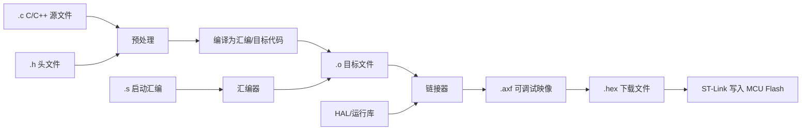
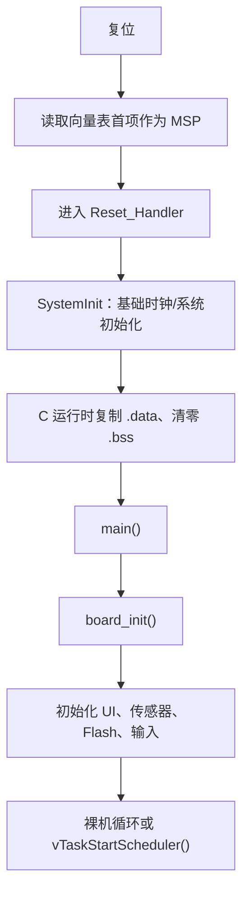

# 01　项目地图与程序如何运行

## 本章目标

完成本章后，你应该能够：

- 从一个功能定位到对应目录、文件和函数；
- 解释 `.c`、`.h`、`.s`、`.uvprojx` 各自的作用；
- 说清楚程序从源代码到写入 Flash 的主要步骤；
- 画出 STM32 从复位到进入主循环或 FreeRTOS 调度器的路径；
- 区分编译错误、链接错误、下载错误和运行错误。

## 1. 项目不是“一堆代码”，而是分层系统

根目录中的两套工程使用相同硬件：

```text
01_BareMetal_Keil/    裸机协作调度版
02_FreeRTOS_Keil/     FreeRTOS 抢占调度版
```

它们的应用驱动基本对应，但系统组织不同。

### 1.1 裸机目录

```text
01_BareMetal_Keil/
├─ App/
│  ├─ Inc/             应用头文件
│  └─ Src/             传感器、OLED、Flash、UI 等实现
├─ Core/
│  ├─ Inc/             板级和中断声明
│  ├─ Src/             board.c、main.c、中断实现
│  └─ Startup/arm/     ARMCC5 启动汇编
├─ System/
│  ├─ Inc/
│  └─ Src/             scheduler、event_bus
├─ Drivers/            HAL、CMSIS、STM32F1 设备头文件
├─ DebugConfig/        Keil 调试配置
└─ stm32_multisensor_baremetal.uvprojx
```

### 1.2 FreeRTOS 目录

FreeRTOS 版没有自研 `System/`，而是增加：

```text
Middlewares/Third_Party/FreeRTOS/
├─ Source/tasks.c
├─ Source/queue.c
├─ Source/list.c
├─ Source/include/
└─ Source/portable/RVDS/ARM_CM3/
```

`portable/RVDS/ARM_CM3` 是 ARMCC5 对 Cortex-M3 的移植层，负责 PendSV、SVC、SysTick 等与处理器有关的部分。

## 2. 从功能定位代码

| 功能 | 主要文件 |
|---|---|
| 时钟、GPIO、I2C、SPI、UART | `Core/Src/board.c` |
| 程序入口和任务组织 | `Core/Src/main.c` |
| 中断处理 | `Core/Src/stm32f1xx_it.c` |
| 公共数据模型 | `App/Inc/app_types.h` |
| 周期和地址配置 | `App/Inc/app_config.h` |
| DS3231 | `App/Src/ds3231.c` |
| SHT30 | `App/Src/sht30.c` |
| BMP280 | `App/Src/bmp280.c` |
| BH1750 | `App/Src/bh1750.c` |
| OLED 驱动 | `App/Src/ssd1306.c` |
| 页面和菜单 | `App/Src/ui_service.c`、`ui_theme_nokia.c` |
| EC11 和按钮 | `App/Src/encoder.c` |
| W25Q64 底层命令 | `App/Src/w25q64.c` |
| 日志与设置服务 | `App/Src/storage_service.c` |
| 裸机调度器 | `System/Src/scheduler.c` |
| 裸机事件队列 | `System/Src/event_bus.c` |

定位时先找“模块入口”，再沿着函数调用向下读。不要从 HAL 的上万行源码开始搜索。

## 3. `.h` 和 `.c` 的职责

头文件描述模块向外提供什么，源文件描述模块内部怎样实现。

以调度器为例，`scheduler.h` 提供：

```c
typedef void (*scheduler_task_fn)(void *context);

void scheduler_init(void);
bool scheduler_add(scheduler_task_fn function, void *context,
                   uint32_t period_ms, uint32_t first_run_ms);
void scheduler_run_ready(uint32_t now_ms);
```

使用者只需要知道这些函数。任务数组 `s_tasks` 是 `scheduler.c` 的内部细节，并使用 `static` 限制在当前翻译单元内。

这种边界很重要：模块应通过公开接口协作，而不是随意访问别的模块内部变量。

## 4. 源代码怎样变成固件



### 4.1 预处理

处理：

- `#include`；
- `#define`；
- `#if/#ifdef`；
- 宏展开。

Classic 与 Nokia Target 的默认主题就是通过编译宏传入：

```c
#ifndef APP_UI_DEFAULT_THEME
#define APP_UI_DEFAULT_THEME 0U
#endif
```

Keil Target 可以把它覆盖为 1，而不需要复制一份 UI 源码。

### 4.2 编译

每个 `.c` 通常独立编译成 `.o`。编译器检查语法、类型，并执行优化。一个源文件看不到另一个源文件内部的 `static` 变量。

### 4.3 链接

链接器解决跨文件符号引用，并把代码和数据放入 Flash/RAM。典型链接错误包括：

- 函数只有声明，没有实现；
- 同一个全局符号被定义两次；
- 加入了错误的 FreeRTOS `port.c`；
- 超出 Flash 或 RAM；
- 中断处理函数名字与向量表不匹配。

### 4.4 下载

F8 之后是 ST-Link 与 MCU 的通信。`No target connected` 属于下载/连接问题，不是 C 语法错误。

## 5. STM32 从复位到 `main()`

简化流程如下：



启动文件 `Core/Startup/arm/startup_stm32f103xb.s` 包含向量表、初始栈和弱中断处理声明。第 8、16 章会详细拆解。

## 6. 裸机入口与 FreeRTOS 入口

### 6.1 裸机

裸机版初始化完成后注册周期任务：编码器、传感器、UI、设置、存储状态机、日志请求和心跳。主循环不断：

```text
运行到期任务 → 派发事件 → WFI 等待中断 → 被 SysTick/EXTI 唤醒
```

它不是“完全没有系统”，而是使用项目自己实现的协作式调度系统。

### 6.2 FreeRTOS

FreeRTOS 版创建 5 个静态任务：

| 任务 | 优先级 | 作用 |
|---|---:|---|
| encoder | 4 | 2 ms 扫描输入并发送 UI 输入队列 |
| sensor | 3 | 每秒采集并发送快照/日志 |
| ui | 2 | 接收数据与输入，更新 OLED |
| storage | 2 | 处理日志和设置保存 |
| health | 1 | 500 ms 心跳 |

随后调用 `vTaskStartScheduler()`，主线程不再以普通 `for(;;)` 方式调度业务。

## 7. 四类错误必须分开

| 阶段 | 典型现象 | 优先检查 |
|---|---|---|
| 编译 | `undeclared identifier`、类型不兼容 | 当前 `.c/.h`、宏、声明 |
| 链接 | `Undefined symbol`、重复定义、超容量 | 工程文件、目标文件、符号 |
| 下载 | `No target connected` | ST-Link、SWD、供电、BOOT0 |
| 运行 | 花屏、HardFault、卡死、数据错误 | 逻辑、内存、时序、接线 |

不要用修改 C 代码的方式解决断线，也不要用换线的方式解决链接符号缺失。

## 8. 本章实验

### 实验 1：功能定位

不使用全文搜索，尝试回答：

1. 蜂鸣器有效电平在哪里配置？
2. OLED I2C 地址在哪里配置？
3. 裸机任务最多能注册几个？
4. FreeRTOS 是否允许动态分配？
5. PB12/PB13 在哪一个文件配置成 EXTI？

然后使用 `rg` 或 VS Code 搜索验证答案。

### 实验 2：观察完整重建

删除一个工程自动生成的 `MDK-ARM/` 后按 F7，观察 Keil 如何重新编译所有 `.c` 和 `.s`。记录：

- 编译了多少个应用文件；
- 何时出现 `linking...`；
- 最终 Program Size；
- AXF 和 HEX 的区别。

### 实验 3：区分错误阶段

只在学习副本中进行：

1. 把一个变量名拼错，观察编译错误。
2. 只声明一个函数但调用它，不提供实现，观察链接错误。
3. 恢复代码，拔掉 ST-Link 后按 F8，观察下载错误。

三次错误的文本和发生阶段完全不同。

## 9. 检查点

- [ ] 能画出从 `.c` 到 `.hex` 的过程。
- [ ] 能解释为什么头文件通常不存放普通函数实现。
- [ ] 能区分编译、链接、下载和运行错误。
- [ ] 能从一个功能找到对应模块。
- [ ] 能说出裸机和 FreeRTOS 程序进入稳定运行后的不同路径。

下一章进入 C 语言的数据、表达式、控制流和二进制思维。

