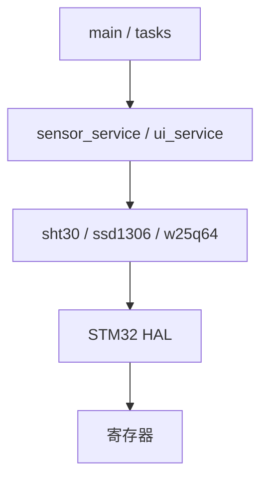

# 03　函数、作用域与多文件工程

## 本章目标

本章解决“一个程序如何从单文件成长为可维护工程”。你将理解函数调用、声明与定义、作用域、存储期、链接属性、头文件和模块接口。

## 1. 函数是带契约的代码单元

```c
bool w25q64_read(uint32_t address, void *data, size_t length);
```

这个声明包含：

- 函数名：`w25q64_read`；
- 返回值：`bool`，表示成功或失败；
- 输入：32 位地址；
- 输出缓冲区：`void *data`；
- 长度：`size_t length`。

调用者不需要知道 CS 怎样拉低、SPI 怎样收发，但必须遵守契约：缓冲区有效、长度非零、地址不能越界。

## 2. 声明、定义和调用

### 2.1 声明

声明告诉编译器“存在这样一个符号”：

```c
bool sensor_init(void);
```

### 2.2 定义

定义提供函数体：

```c
bool sensor_init(void)
{
    return true;
}
```

### 2.3 调用

```c
if (!sensor_init()) {
    handle_error();
}
```

如果声明存在但链接时找不到定义，会出现 Undefined Symbol。它不是语法问题，而是链接问题。

## 3. 参数按值传递

C 的函数参数按值传递：

```c
void increment(uint32_t value)
{
    ++value;
}

int main(void)
{
    uint32_t count = 1U;
    increment(count);
    /* count 仍然是 1 */
}
```

函数内部得到 `count` 的副本。要修改调用者数据，需要传地址：

```c
void increment(uint32_t *value)
{
    if (value != NULL) {
        ++(*value);
    }
}
```

指针将在下一章详细解释。这里先记住：C 没有真正的“引用传递”，传指针仍然是把地址值复制给函数。

## 4. 返回值与输出参数

一个函数只能直接返回一个值，但可以通过指针输出更多数据：

```c
bool read_temperature(float *temperature, float *humidity);
```

调用：

```c
float t;
float h;
if (read_temperature(&t, &h)) {
    /* t、h 有效 */
}
```

项目常使用“返回成功状态 + 输出参数”模式。优点是错误判断显式，缺点是调用者必须提供有效地址。

另一种方式是返回结构体：

```c
typedef struct {
    bool ok;
    float temperature;
    float humidity;
} measurement_result_t;
```

选择取决于接口清晰度、对象大小和编译器 ABI。小结构体返回通常可读性很好。

## 5. 作用域

作用域决定名字在源码的哪些位置可见。

### 5.1 块作用域

```c
if (ready) {
    uint32_t local = 1U;
}
/* 此处不能使用 local */
```

### 5.2 函数作用域

标签用于 `goto`，标签名在整个函数中可见。一般业务代码很少需要 `goto`，但它可用于统一释放多项资源。

### 5.3 文件作用域

在函数外定义的名字具有文件作用域：

```c
static uint32_t s_sequence;
```

`s_sequence` 从声明位置到文件末尾可见。

## 6. 存储期与作用域不是同一件事

| 对象 | 常见位置 | 存储期 | 默认初始化 |
|---|---|---|---|
| 自动局部变量 | 函数/块内 | 进入块到离开块 | 不确定 |
| 静态局部变量 | 函数内加 `static` | 整个程序 | 0 |
| 文件作用域变量 | 函数外 | 整个程序 | 0 |
| 动态对象 | `malloc` 获得 | `malloc` 到 `free` | 不确定 |

```c
uint32_t next_id(void)
{
    static uint32_t id;
    return ++id;
}
```

`id` 的名字只能在函数内使用，但对象从启动到程序结束一直存在。

在 MCU 上“程序结束”通常意味着复位或断电。

## 7. `static` 的两个常见含义

### 7.1 文件内部链接

```c
static uint8_t s_buffer[1024];
static void cs_low(void);
```

在文件作用域，`static` 让符号只在当前 `.c` 内可见，防止模块外部误用，也避免不同文件的内部名字冲突。

SSD1306 的帧缓冲、W25Q64 的 SPI Handle、调度器任务表都适合隐藏。

### 7.2 静态存储期

在函数内，`static` 让局部对象跨调用保留：

```c
void heartbeat(void)
{
    static bool on;
    on = !on;
    board_led_set(on);
}
```

它不在普通调用栈上反复创建。

## 8. `extern`

`extern` 声明一个在别处定义的外部符号：

```c
/* board.h */
extern I2C_HandleTypeDef hi2c1;
```

```c
/* board.c */
I2C_HandleTypeDef hi2c1;
```

头文件只声明一次，恰好一个 `.c` 提供定义。若在头文件直接写：

```c
I2C_HandleTypeDef hi2c1; /* 不推荐放在头文件 */
```

每个包含它的 `.c` 都可能产生定义，引发重复符号。

## 9. 头文件的设计

一个模块通常包含：

```text
foo.h   对外类型、宏、函数声明
foo.c   内部状态、私有函数、实现
```

### 9.1 Include Guard

```c
#ifndef SENSOR_SERVICE_H
#define SENSOR_SERVICE_H

/* declarations */

#endif
```

它防止同一头文件经不同路径重复展开。

### 9.2 头文件应自包含

如果公开声明使用 `bool` 和 `uint32_t`，头文件自己包含：

```c
#include <stdbool.h>
#include <stdint.h>
```

不能依赖调用者“碰巧先包含了别的头文件”。

### 9.3 只公开必要内容

内部缓冲区、辅助函数、私有状态应留在 `.c`。公开越少，模块越容易修改而不影响其他文件。

## 10. 模块接口实例

设计一个蜂鸣器模块：

```c
/* buzzer.h */
#ifndef BUZZER_H
#define BUZZER_H

#include <stdbool.h>
#include <stdint.h>

void buzzer_init(void);
void buzzer_set(bool on);
void buzzer_start_pulse(uint32_t now_ms, uint32_t duration_ms);
void buzzer_update(uint32_t now_ms);

#endif
```

实现隐藏状态：

```c
/* buzzer.c */
#include "buzzer.h"

static bool s_active;
static uint32_t s_deadline_ms;

void buzzer_start_pulse(uint32_t now_ms, uint32_t duration_ms)
{
    s_active = true;
    s_deadline_ms = now_ms + duration_ms;
    buzzer_set(true);
}

void buzzer_update(uint32_t now_ms)
{
    if (s_active && (int32_t)(now_ms - s_deadline_ms) >= 0) {
        s_active = false;
        buzzer_set(false);
    }
}
```

调用者不直接接触 `s_active`，只能通过接口改变模块状态。

## 11. 依赖方向

理想方向是：



上层可以调用下层，下层不应反过来依赖具体页面或业务。比如 SHT30 驱动不应该直接绘制 OLED；它只返回温湿度和成功状态。

## 12. 错误处理契约

嵌入式 C 常用：

```c
bool operation(...);
```

或者：

```c
typedef enum {
    DRIVER_OK = 0,
    DRIVER_INVALID_ARGUMENT,
    DRIVER_TIMEOUT,
    DRIVER_CRC_ERROR,
    DRIVER_BUS_ERROR
} driver_result_t;
```

`bool` 简单，但无法区分原因；枚举更详细，但调用代码更长。底层驱动可返回详细错误，上层服务再决定是否重试、降级、记录或报警。

## 13. Target 宏与条件编译

同一份代码支持不同默认主题：

```c
#ifndef APP_UI_DEFAULT_THEME
#define APP_UI_DEFAULT_THEME 0U
#endif
```

Keil Target 的预定义宏可以覆盖默认值。条件编译适合硬件变体、调试功能和编译期常量，但不适合把普通运行逻辑全部变成大量 `#ifdef`。

## 14. 常见模块化错误

- 把大量全局变量写进头文件；
- 公开模块内部数组；
- 头文件依赖包含顺序；
- 函数名字过于通用，如 `init()`；
- 底层驱动直接修改 UI；
- 头文件相互循环包含；
- 一个函数同时初始化硬件、读取数据、更新菜单和写 Flash；
- 调用者不检查失败返回值。

## 15. 练习

1. 为“状态 LED”设计一个 `.h/.c` 接口，包含设置、翻转和周期闪烁。
2. 解释为什么 `ssd1306.c` 的 `s_buffer` 应是 `static`。
3. 找出项目中一个 `extern` 变量的声明和定义。
4. 把一个返回 `bool` 的接口改写成错误枚举，列出至少四种错误。
5. 画出 `main → sensor_service → sht30 → HAL_I2C` 的依赖方向。
6. 解释“作用域”和“存储期”为什么不是同一个概念。

检查点：你能从零写出一个自包含头文件，并保证只有必要接口对外公开。

