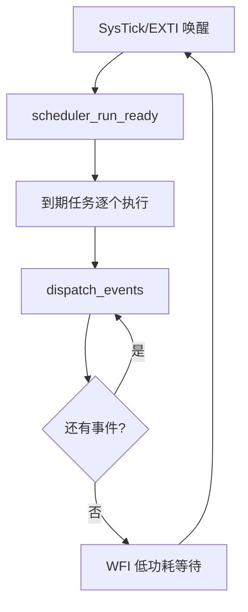
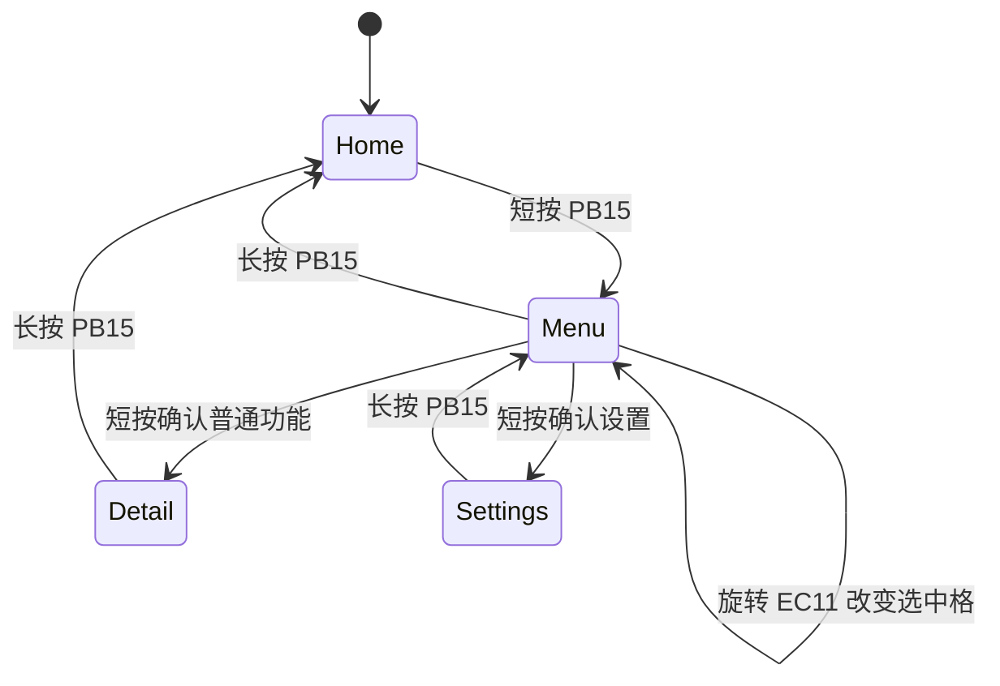

# 第 11 章：裸机调度、事件总线与状态机

“裸机”不等于没有系统设计。你的裸机版已经包含一个小型协作式运行框架：固定容量周期调度器、事件队列、非阻塞状态机、脏标记 UI 和低功耗等待。本章把它作为一个微型操作系统来分析。

## 11.1 当前裸机系统的完整运行逻辑

上电初始化完成后，`main()` 进入：

```c
for (;;) {
    scheduler_run_ready(HAL_GetTick());
    dispatch_events();
    __WFI();
}
```

每一轮做三件事：

1. 执行所有已到期的周期任务；
2. 消费事件队列并更新业务/UI 状态；
3. 若当前无指令可做，用 `WFI` 等待下一次中断。

SysTick 每 1 ms 到来会唤醒 CPU，编码器 EXTI 等中断也可提前唤醒。它不是“执行到 `WFI` 后永久睡死”。



## 11.2 当前任务表

裸机调度器最多容纳 8 个任务，当前注册 7 个：

| 任务 | 周期 | 主要职责 |
|---|---:|---|
| encoder | 2 ms | 消费 EC11 状态、PB15 消抖，发布输入事件 |
| sensor | 1000 ms | 读取 RTC、温湿度、气压、光照，提交快照 |
| UI | 20 ms | 仅在 dirty 或动画进行时绘制/刷新 |
| settings | 配置值 | 检查 UI 设置变化并请求后台保存 |
| storage service | 5 ms | 推进擦除/编程/校验状态机 |
| log request | 60000 ms | 请求追加当前快照 |
| heartbeat | 500 ms | 翻转板载 LED |

周期表示“最早多久获得一次运行机会”，不是函数必须占用这么久，也不是硬实时承诺。

## 11.3 协作式调度的核心合同

协作式系统没有内核在任意指令处抢占普通任务。因此每个任务必须主动快速返回。

任务合同可以写成：

> 一次调用只完成一个短步骤，不等待人、不长时间等待外设、不执行无法界定的循环，然后把控制权交还主循环。

违反合同的例子：

```c
while (!button_pressed()) { }        /* 等人 */
HAL_Delay(2000);                     /* 阻塞两秒 */
while (flash_busy()) { }             /* 等器件 */
for (;;) { retry_sensor(); }         /* 无限重试 */
```

正确方向是记录状态和截止时间，下次调度继续。

## 11.4 调度器数据结构

`scheduler_entry_t` 包含：

```c
typedef struct {
    scheduler_task_fn function;
    void *context;
    uint32_t period_ms;
    uint32_t next_run_ms;
    bool used;
} scheduler_entry_t;
```

这里同时应用了：

- 函数指针：统一调用不同任务；
- `void *context`：给通用回调传递任务私有上下文；
- 结构体：把函数、参数、周期和状态组合成记录；
- 固定数组：无动态内存，容量和成本确定；
- `bool used`：标记槽是否有效。

### 11.4.1 为什么使用函数指针

若不用函数指针，调度器只能硬编码：

```c
task_encoder();
task_sensor();
task_ui();
```

使用统一签名后，调度器不需要知道任务业务。新增任务只需注册，无需修改调度循环。这是 C 语言中的“行为抽象”，也是以后理解 C++ 虚函数的重要桥梁。

## 11.5 截止时间、漂移与错过周期

当前调度器到期后先：

```c
task->next_run_ms += task->period_ms;
```

这种基于旧截止时间累加的方法可避免普通执行时间造成长期漂移。例如周期 100 ms，实际在 101 ms 执行，下一次仍目标 200 ms，而不是 201 ms。

如果系统已经落后超过一个周期，代码把下一次设为：

```c
task->next_run_ms = now_ms + task->period_ms;
```

目的是避免同一任务连续补跑大量历史周期形成“追赶风暴”。

这是一项策略选择：

| 策略 | 行为 | 适合 |
|---|---|---|
| 全部补跑 | 漏 5 次就立即跑 5 次 | 必须逐样本处理的离线逻辑 |
| 跳过旧周期 | 只跑一次，从现在重新安排 | UI、状态检查、普通传感器 |
| 累计数量后批处理 | 知道漏几次，但合并计算 | 计量、统计 |

## 11.6 调度复杂度与扩展上限

当前每轮线性扫描最多 8 个槽，复杂度 `O(N)`。对 8 个任务几乎没有优化必要：

- 数组连续，缓存/总线访问简单；
- 不需要堆或链表；
- 最坏扫描次数确定；
- 代码极小且容易证明。

若扩展到数百个软件定时器，才值得考虑按截止时间排序、小根堆、时间轮或分层定时器。对当前规模，把调度器改成复杂树结构只会降低可维护性。

## 11.7 响应时间与最坏执行时间

协作式系统中，高频任务可能被它前面的长任务阻塞。一个事件的响应延迟近似受以下因素影响：

```text
当前正在执行任务的剩余时间
+ 前面所有到期任务的执行时间
+ 主循环和事件分发时间
+ 最多一个 tick 的等待量化误差
```

设任务 i 的最坏执行时间为 `C_i`，周期为 `T_i`，粗略 CPU 利用率：

```text
U = Σ(C_i / T_i)
```

但 `U < 100%` 仍不保证所有响应都好，因为一个 30 ms 的阻塞 I2C 操作就能让 2 ms 编码器任务延迟 30 ms。

因此必须同时观察：

- 平均执行时间；
- 最坏执行时间 WCET；
- 抖动；
- 最长不可抢占段；
- 队列峰值；
- 截止时间错过次数。

## 11.8 如何测量任务执行时间

### 方法 A：GPIO 脉冲

任务入口置高测试引脚，出口置低，用示波器/逻辑分析仪测脉宽。这是最可信且对工具链要求低的方法。

### 方法 B：DWT 周期计数器

Cortex-M3 的 DWT CYCCNT 可在允许时记录 CPU 周期。72 MHz 下：

```text
时间（微秒） = 周期数 / 72
```

但要正确使能调试跟踪组件，并注意计数回绕。

### 方法 C：毫秒 tick

`HAL_GetTick()` 只能分辨毫秒，不适合测几十微秒的函数，但可发现明显长阻塞。

建议给每个任务维护：调用次数、最大耗时、总耗时、错过周期次数，再通过 UART 低频输出。不要在每次任务入口都 `printf`，日志本身会改变被测系统。

## 11.9 事件总线：时间与业务解耦

周期任务负责“什么时候检查/采样”，事件负责“发生了什么”。当前事件类型包括：

- 新快照；
- 存储错误；
- 编码器顺/逆时针；
- 点击；
- 长按。

生产者调用 `event_bus_post()`，主循环调用 `event_bus_pop()` 并分发。编码器任务不需要直接知道 Nokia 菜单如何移动，传感器任务也不需要直接刷新 OLED。

## 11.10 固定环形事件队列

队列长度 16，维护 `head`、`tail`、`count` 和 `dropped`。

入队：

```text
queue[tail] = event
tail = (tail + 1) mod 16
count++
```

出队：

```text
event = queue[head]
head = (head + 1) mod 16
count--
```

满时不覆盖旧事件，而是增加 `dropped` 并返回失败。这是一种明确的背压策略。

### 11.10.1 当前事件总线的并发边界

它没有临界区，也没有使用原子操作，所以当前安全前提是：

- `post` 和 `pop` 都在主循环普通上下文中调用；
- EXTI ISR 不直接调用 `event_bus_post()`；
- 没有两个抢占线程同时访问计数器。

若未来从 ISR 发布，必须重新设计：

- 用极短临界区保护共享索引；
- 或使用单生产者/单消费者无锁条件并严格证明；
- 或 ISR 只更新一个原子/volatile 累计量，由任务转发；
- FreeRTOS 中使用 `xQueueSendFromISR()`。

不能因为变量加了 `volatile` 就认为队列线程安全。

## 11.11 队列满了应该怎么办

不同事件需要不同策略：

| 事件 | 可否合并 | 建议 |
|---|---|---|
| 新快照 | 可以 | 只保留“有新数据”标志，UI 读最新快照 |
| 编码器旋转 | 可累计 | 合并为有符号步数，防止快速旋转塞满队列 |
| 点击 | 通常不可随意丢 | 保留边沿，做好消抖和容量 |
| 存储错误 | 重复可合并 | 错误状态置位并统计次数 |

这引出一个重要概念：不是所有消息都必须排队。状态适合“读最新值”，事件适合“每次都要处理”。

## 11.12 UI 脏标记

`s_ui_dirty` 表示模型变化，需要重绘。UI 周期任务只有在：

```c
if (s_ui_ready && s_ui_dirty) { ... }
```

时才工作。刷新后，如果动画仍活动，dirty 保持为真；否则清除。

这避免无变化画面每 20 ms 重绘。它与 SSD1306 差异更新形成两级优化：

1. 业务层：没变化就根本不渲染；
2. 驱动层：渲染后只发送变化字节。

如果要进一步优化，可把 UI 分成 model dirty、layout dirty、animation dirty 和 status dirty，但当前单一标志已能覆盖小型项目。

## 11.13 UI 状态机与菜单逻辑

界面不是一堆互相调用的绘图函数，而应看作有限状态机。抽象状态可包括：

- 首页；
- 四宫格主菜单；
- 传感器详情；
- 设置页；
- 主题选择；
- 蜂鸣器设置；
- 过渡动画。

输入事件引起状态转移：



具体页面名称以 `ui_service.c`/`ui_theme_nokia.c` 当前实现为准，但分析方法不变：

```text
新状态 = transition(旧状态, 输入事件)
画面 = render(当前状态, 当前数据, 动画进度)
```

把状态转移和渲染分离，能避免“画了某个页面但内部状态没跟上”的错误。

## 11.14 非阻塞存储状态机是调度器的典型任务

存储任务每 5 ms 运行一次，只推进一个阶段：

- 空闲时接受 pending 请求；
- 启动擦除后返回；
- 后续轮询 busy；
- ready 后启动编程；
- 再次 ready 后读取校验；
- 完成或报错。

状态机把一段“线性但阻塞”的伪代码，变成多轮调用的增量算法。这种转换对蜂鸣器、传感器转换、通信重试、动画和网络协议都通用。

### 11.14.1 通用状态机骨架

```c
typedef enum {
    OP_IDLE,
    OP_WAITING,
    OP_VERIFY,
    OP_ERROR
} op_state_t;

void op_process(uint32_t now)
{
    switch (state) {
    case OP_IDLE:
        if (request_pending) {
            start_hardware();
            deadline = now + TIMEOUT_MS;
            state = OP_WAITING;
        }
        break;

    case OP_WAITING:
        if (hardware_ready()) {
            state = OP_VERIFY;
        } else if ((int32_t)(now - deadline) >= 0) {
            state = OP_ERROR;
        }
        break;

    case OP_VERIFY:
        state = verify() ? OP_IDLE : OP_ERROR;
        break;

    case OP_ERROR:
        safe_shutdown();
        break;
    }
}
```

## 11.15 `WFI`、空闲与功耗

没有 `WFI` 时，主循环会不停扫描 8 个任务和空队列，CPU 100% 活跃却没有产出。`WFI` 让内核等待中断，降低动态功耗和无意义总线活动。

当前 SysTick 仍每 1 ms 唤醒，因此不是最低功耗。更高级方案是 tickless idle：计算最近截止时间，用低功耗定时器一次唤醒。但它会影响 HAL tick、超时和调试，当前教学项目不必急于实施。

## 11.16 当前设计已经很合适的部分

以下部分对当前规模已接近“无需再复杂化”的合理点：

- 8 槽固定数组线性扫描；
- 32 位回绕安全时间比较；
- `void (*)(void *)` 通用任务回调；
- 固定 16 项环形队列和丢弃统计；
- UI 脏标记；
- Flash 等待状态机；
- `WFI` 空闲等待；
- 无动态内存的核心运行路径。

“接近极致”应理解为成本收益对当前规模最合适，而不是绝对不能再减少几个周期。

## 11.17 仍可优化的部分

按优先级建议：

1. **测量任务 WCET 和调度延迟**：没有数据就无法判断下一步；
2. **让蜂鸣器完全非阻塞**：当前启动 40 ms 和存储错误 100 ms 仍使用短阻塞脉冲，虽影响有限，但可统一状态机；
3. **I2C 访问仲裁/恢复**：加入错误计数和总线恢复；
4. **传感器分阶段采样**：若单次读所有设备造成明显长阻塞，可拆成多个阶段；
5. **事件合并**：快速旋转时累计步数，避免 16 项队列溢出；
6. **调度统计**：最大运行时间、错过周期、队列高水位；
7. **看门狗**：以系统健康条件喂狗，而非无条件喂；
8. **故障降级**：单个 I2C 设备故障时其他功能继续；
9. **启动扫描增量化**：Flash 日志区扫描若增长很大，可分批或用索引元数据。

## 11.18 裸机系统何时不够用

出现以下情况时可考虑 RTOS：

- 多个独立功能都需要等待事件；
- 任务优先级与抢占对响应很重要；
- 通信栈或第三方组件天然按阻塞线程模型编写；
- 需要标准队列、信号量、互斥锁、通知、软件定时器；
- 手写状态机数量已使可读性明显下降。

但 RTOS 不会自动修复长临界区、坏驱动、无超时循环和错误资源共享。它改变问题的组织方式，也引入栈、调度和并发风险。

## 11.19 实验与练习

### 实验 A：故意制造长任务

在实验分支给低频任务加入 30 ms 忙等待，快速旋转编码器，观察输入和动画。恢复后再对比。目的不是保留坏代码，而是建立“协作式最坏阻塞时间”的直觉。

### 实验 B：队列高水位

给事件总线增加 `max_count`，每次入队后更新峰值。快速旋转并切菜单，低频打印峰值和 dropped。不要每次入队都串口打印。

### 练习

1. 设计支持 one-shot 任务的调度器字段和 API。
2. 设计取消任务，但不能在遍历时破坏当前回调。
3. 把 `task_sensor` 拆成 RTC/SHT30/BMP280/BH1750 四阶段，分析快照何时提交。
4. 将旋转事件合并为 `APP_EVENT_ENCODER_DELTA`，`value` 里保存有符号步数。讨论无符号字段如何安全编码。
5. 给调度器加入最大延迟统计：`lateness = now - next_run`。
6. 解释为什么当前 event bus 不能直接在 EXTI ISR 中安全调用。

下一章将用同一套功能对照 FreeRTOS 的任务、优先级、队列、互斥锁和上下文切换。
