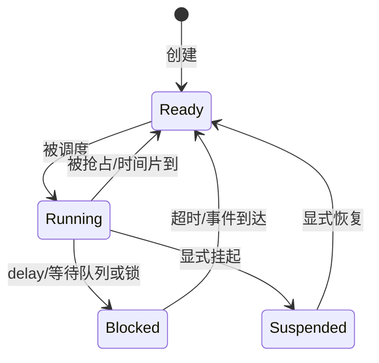

# 第 12 章：FreeRTOS 任务、队列、互斥锁与并发

FreeRTOS 版本保持相同硬件和业务目标，但执行模型从“一个主循环协作推进”变成“多个拥有独立栈的任务由内核调度”。本章既讲原理，也如实分析当前代码，而不是默认 RTOS 版天然更快。

## 12.1 本章目标

学完后，你应能：

- 解释任务、TCB、任务栈和上下文切换；
- 区分 Ready、Running、Blocked、Suspended；
- 正确理解优先级与抢占；
- 使用 `vTaskDelayUntil()` 建立稳定周期；
- 根据“状态”还是“事件”选择 overwrite queue 或普通 queue；
- 解释互斥锁、优先级继承、死锁和锁粒度；
- 计算静态任务栈与队列的 SRAM 成本；
- 识别当前 FreeRTOS 版仍可优化的同步和阻塞问题。

## 12.2 当前内核配置

`Core/Inc/FreeRTOSConfig.h` 的关键项：

| 配置 | 当前值 | 含义 |
|---|---:|---|
| `configUSE_PREEMPTION` | 1 | 高优先级 Ready 任务可抢占 |
| `configTICK_RATE_HZ` | 1000 | 1 tick = 1 ms |
| `configMAX_PRIORITIES` | 5 | 可用优先级 0–4 |
| `configUSE_TIME_SLICING` | 1 | 同优先级 Ready 任务可按 tick 时间片轮转 |
| `configSUPPORT_STATIC_ALLOCATION` | 1 | 支持静态创建 |
| `configSUPPORT_DYNAMIC_ALLOCATION` | 0 | 禁止动态创建 |
| `configUSE_MUTEXES` | 1 | 启用互斥锁与优先级继承 |
| `configCHECK_FOR_STACK_OVERFLOW` | 2 | 启用较完整的栈溢出检查 |
| `configUSE_TASK_NOTIFICATIONS` | 1 | 可使用轻量任务通知 |
| `configUSE_TIMERS` | 0 | 未启用软件定时器服务 |
| `configUSE_TICKLESS_IDLE` | 0 | 未启用无 tick 空闲 |

项目使用 ARMCC5 对应的 RVDS Cortex-M3 port，并把 SVC 与 PendSV 映射到 FreeRTOS 处理函数。

## 12.3 当前五个静态任务

| 任务 | 优先级 | 栈（word） | 周期/阻塞方式 | 职责 |
|---|---:|---:|---|---|
| encoder | 4 | 160 | `vTaskDelayUntil(2 ms)` | 轮询 EC11/PB15，发送输入 |
| sensor | 3 | 384 | `vTaskDelayUntil(1000 ms)` | 读传感器，发送 UI/日志快照 |
| ui | 2 | 384 | 队列等待最多 20 ms | 处理输入、绘制 OLED |
| storage | 2 | 320 | 日志队列等待最多 500 ms | 同步写日志/设置 |
| health | 1 | 128 | `vTaskDelayUntil(500 ms)` | 心跳 LED |

另有内核 idle task，静态栈 128 words。

在 Cortex-M3 端口中 `StackType_t` 通常为 32 位。因此仅这些显式任务栈大致占用：

```text
(160 + 384 + 384 + 320 + 128 + 128) × 4
= 1504 × 4
= 6016 字节
```

再加每个任务的 TCB、4 个队列控制块和存储、互斥锁、OLED 缓冲、应用全局数据，SRAM 成本明显高于裸机版。必须查看 Keil Map/Build 输出确认最终余量。

## 12.4 任务为什么需要独立栈

每个任务都像一个暂停和恢复的普通 C 函数：

```c
static void task_health(void *argument)
{
    for (;;) {
        board_led_toggle();
        vTaskDelayUntil(...);
    }
}
```

当它阻塞时，局部变量、函数调用链和返回位置必须保留。任务栈保存：

- 局部变量；
- 函数参数和部分返回信息；
- 编译器保存的寄存器；
- 中断/切换上下文；
- 某些库函数的临时数据。

TCB（Task Control Block）保存任务状态、优先级、栈指针、列表节点、名字等内核信息。

## 12.5 任务状态



当前配置没有启用 `vTaskSuspend` API，也不删除任务。所有应用任务创建后永久循环，主要在 Blocked 与 Ready/Running 之间切换。

阻塞不是忙等待。一个任务在 `xQueueReceive(..., timeout)` 或 `vTaskDelayUntil()` 阻塞后，不占 CPU；内核可运行其他任务或 idle task。

## 12.6 抢占、优先级和响应

数值越大优先级越高。encoder=4，因此每 2 ms 醒来后可抢占 sensor/ui/storage/health。sensor=3 可抢占 UI/storage/health。

但高优先级不是“总是更快”的免费开关：

- 若高优先级任务从不阻塞，低优先级任务会饿死；
- 若 ISR 长时间关中断，所有任务都无法及时切换；
- 若高优先级任务等待低优先级持有的资源，可能发生优先级反转；
- 高优先级任务的栈越界或死循环影响更大。

编码器任务必须在每轮末尾 delay，这一点是系统可调度性的必要条件。

## 12.7 `vTaskDelay` 与 `vTaskDelayUntil`

### 12.7.1 相对延时

```c
work();
vTaskDelay(pdMS_TO_TICKS(100));
```

下一轮间隔等于“工作时间 + 100 ms”，会累积漂移。

### 12.7.2 绝对周期

```c
TickType_t last_wake = xTaskGetTickCount();
for (;;) {
    work();
    vTaskDelayUntil(&last_wake, pdMS_TO_TICKS(100));
}
```

它按上一个计划唤醒时刻推进，适合采样和心跳。当前 encoder、sensor、health 都采用此方式。

若工作时间超过周期，任务可能立刻再次运行。仍需监控超期，而不能认为用了 `DelayUntil` 就自动满足时限。

## 12.8 当前四个静态队列

| 队列 | 长度 | 元素类型 | 语义 |
|---|---:|---|---|
| UI queue | 1 | `app_snapshot_t` | 最新状态，使用 overwrite |
| log queue | 2 | `app_snapshot_t` | 每次日志请求，普通 send |
| encoder queue | 8 | `ui_input_t` | 离散输入事件 |
| settings queue | 1 | `ui_settings_t` | 最新设置，使用 overwrite |

### 12.8.1 为什么 UI 快照队列长度为 1

UI 通常只关心最新传感器状态。如果 UI 暂时忙，保存每秒的所有历史快照没有意义。`xQueueOverwrite()` 原子地用新快照替换旧快照，表达“latest value”语义。

### 12.8.2 为什么日志不能简单 overwrite

日志代表需要持久化的事件。若写入暂时慢，覆盖旧请求等于静默丢日志。当前长度 2 是一个很小的缓冲，发送使用 0 超时；若队列满，返回值当前被忽略，这意味着仍可能无声丢记录。

改进应至少统计：

```c
if (xQueueSend(s_log_queue, &snapshot, 0U) != pdTRUE) {
    ++log_queue_dropped;
}
```

是否增大队列要根据最坏 Flash 写入时间和日志产生速率计算，而不是随意设大。

## 12.9 队列复制和所有权

FreeRTOS 队列按元素大小复制字节。发送局部变量是安全的：

```c
app_snapshot_t snapshot;
xQueueSend(queue, &snapshot, ...);
```

函数返回后，队列中已有独立副本。

若队列元素是指针，则只复制地址；指向对象的生命周期、所有权和并发修改必须另行设计。小型固定结构用值复制更简单、更安全，代价是复制时间与队列 SRAM。

## 12.10 I2C 互斥锁

sensor 任务和 UI 任务共享同一个 I2C1 控制器。若一个任务正在与 SHT30 传输，另一个任务插入 OLED 命令，HAL 句柄状态和总线事务都会被破坏。

当前使用静态 mutex：

```c
if (xSemaphoreTake(s_i2c_mutex, pdMS_TO_TICKS(500)) == pdTRUE) {
    /* 完整 I2C 事务组 */
    xSemaphoreGive(s_i2c_mutex);
}
```

### 12.10.1 锁保护的是什么

锁不是保护某个 C 变量名字，而是保护一个资源不变量：

> 任意时刻只有一个任务可以使用 I2C1 句柄与总线执行不可交错的事务。

所有访问 I2C1 的任务都必须遵守同一把锁。若某个新任务绕过锁直接调用 HAL，互斥保证就失效。

### 12.10.2 为什么用 mutex 而不是 binary semaphore

FreeRTOS mutex 支持优先级继承。若低优先级 UI 持锁，高优先级 sensor 等锁，内核可暂时提升持锁任务优先级，让它尽快释放资源，减轻优先级反转。

但优先级继承不能解决：

- 忘记释放锁；
- 同任务重复拿非递归锁；
- A 锁后等 B，另一个任务 B 锁后等 A 的死锁；
- 持锁期间执行 500 ms 无关计算；
- ISR 错误地使用普通 mutex API。

## 12.11 锁粒度

锁得太细，设备多字节事务可能交错；锁得太粗，其他任务长时间等待。

传感器任务当前一次拿锁后读取所有 I2C 传感器。这确保整个快照读取连续，但 OLED 最坏要等待所有传感器通信完成。另一种设计是每个设备读操作单独拿锁；响应更公平，但快照时间跨度更大、锁操作更多。

选择依据：

- 单次总线占用时间；
- UI 可接受延迟；
- 快照一致性要求；
- 任务优先级；
- 是否使用异步 I2C/DMA。

## 12.12 上下文切换如何发生

FreeRTOS Cortex-M3 端口主要使用：

- SysTick：产生系统 tick、使延时到期；
- PendSV：在低异常优先级执行上下文切换；
- SVC：启动第一个任务等内核服务。

粗略过程：

1. tick 或 API 使更高优先级任务 Ready；
2. 内核请求 PendSV；
3. PendSV 保存当前任务 R4–R11 和 PSP 等；
4. 把当前栈指针写入 TCB；
5. 选择最高优先级 Ready 任务；
6. 从其 TCB 取栈指针并恢复寄存器；
7. 异常返回到新任务。

硬件异常入口已自动保存另一部分寄存器。内核端口汇编补齐其余部分。

上下文切换有成本，所以把一个几十微秒工作拆成许多相互唤醒的任务未必更高效。

## 12.13 中断优先级与 FromISR API

`configLIBRARY_MAX_SYSCALL_INTERRUPT_PRIORITY` 当前为 5。能调用 FreeRTOS `...FromISR()` API 的中断优先级必须满足端口规则；在 STM32 数值越小硬件优先级越高，直觉容易反转。

原则：

- 普通任务 API 不能在 ISR 调用；
- ISR 要用 `xQueueSendFromISR()`、`vTaskNotifyGiveFromISR()` 等；
- 传入 `pxHigherPriorityTaskWoken`，退出前按端口宏请求切换；
- 超过允许 syscall 优先级的高紧急 ISR 不能调用内核 API；
- 不要随意更改分组和优先级而不核对 `configPRIO_BITS`。

当前 FreeRTOS 编码器版仍使用 2 ms 任务轮询，没有在 EXTI ISR 中发送队列。

## 12.14 HAL tick 与 FreeRTOS tick

当前 `SysTick_Handler()` 同时：

```c
HAL_IncTick();
if (scheduler_started) {
    xPortSysTickHandler();
}
```

因此 HAL 毫秒 tick 和 FreeRTOS tick 都由同一个 SysTick 推进。好处是简单，风险是：

- 更换 HAL 时间基准时要同步检查；
- 在高优先级 ISR 中调用依赖 HAL tick 的阻塞 API可能无法等到 tick 更新；
- tick handler 优先级必须满足 FreeRTOS 端口要求；
- 调试暂停后超时行为需要理解。

任务周期优先使用 FreeRTOS tick/API，驱动已有 HAL 超时仍可使用 `HAL_GetTick()`，但要清楚两个时间基准在当前实现中同源。

## 12.15 静态分配

当前任务通过 `xTaskCreateStatic()` 创建，队列通过 `xQueueCreateStatic()` 创建，互斥锁也使用静态控制块。

优点：

- 链接时即可看到大部分 SRAM；
- 无运行期 malloc 失败和碎片；
- 创建后的地址稳定；
- 适合固定功能 MCU。

代价：

- 必须手工规划栈和队列；
- 预留过大浪费 SRAM；
- 预留过小可能栈溢出/队列丢失；
- 配置改动要重新估算。

## 12.16 栈大小如何优化

不要只凭感觉把 384 改为 128。建议：

1. 保持栈溢出钩子开启；
2. 运行最重路径：OLED 全刷、格式化浮点、所有传感器成功、错误日志；
3. 调用 `uxTaskGetStackHighWaterMark()` 记录历史最小剩余 word；
4. 留出中断嵌套、编译优化变化和未来修改余量；
5. 每次大改后重新测。

高水位是“到目前为止最少剩余”，测试没覆盖的路径仍可能更深。

注意 `printf`/浮点格式化、较大局部数组、层层 HAL 调用会显著增加栈。把只读大表放 Flash，把可共享且受控的大缓冲改为静态对象，可能降低任务栈，但会改变重入性。

## 12.17 当前 FreeRTOS 版与裸机优化版的实际差异

两版业务目标相同，但底层优化尚未完全同步：

| 项目 | 裸机版 | 当前 FreeRTOS 版 |
|---|---|---|
| 编码器 A/B | EXTI + 2 ms 消费 | 2 ms 任务轮询 |
| 存储等待 | 分阶段异步状态机 | storage 任务中同步 append/save |
| OLED | 已有差异页/列刷新 | 应以该版本 `ssd1306.c` 实际实现核对，不能假设完全同步 |
| 调度 | 协作式固定任务表 | 抢占式任务 + 队列/锁 |
| SRAM | 单共享栈为主 | 每任务独立栈约 6 KiB 加 TCB |
| UI 唤醒 | 20 ms 周期且 dirty 才刷新 | 队列等待 20 ms，输入也触发重绘 |

因此比较性能时，要先把驱动版本和业务行为对齐，否则测到的差异不只来自调度器。

## 12.18 当前 FreeRTOS 版可优先改进之处

### 12.18.1 存储忙等待

当前 W25Q64 ready 等待使用基于 `HAL_GetTick()` 的轮询，storage 任务可能持续占 CPU。虽然同优先级 UI 可因时间片获得执行机会，高优先级 encoder/sensor 可抢占，但低优先级 health 可能延后。

改进选择：

- 轮询间加入 `vTaskDelay(1)`，简单但粒度为 tick；
- 把裸机存储状态机移植为 RTOS task 的分阶段逻辑；
- 使用任务通知/定时唤醒；
- 若 Flash 有可用 ready/busy 引脚则用中断，但常见 6 脚模块没有。

### 12.18.2 错误和丢队列统计

目前部分 `xQueueSend(..., 0)` 返回值被忽略。应统计 encoder/log/settings 丢失次数，并在 health 任务低频报告。

### 12.18.3 UI 动画推进

当前 UI 只有收到快照、输入或超时循环检查时才决定 redraw。要确认 `ui_service_animation_active()` 是否会持续驱动每个动画帧；若没有，Nokia 过渡可能只显示起止状态。可用明确的 animation deadline 或 task notification 触发。

### 12.18.4 `s_flash_ready` 共享状态

它被声明为 `volatile bool`，storage 写、UI 读。`volatile` 保证访问不会被轻易省略，不提供高层同步、事件顺序或多字段一致性。更清晰方案是：

- storage 通过队列/通知发布状态；
- 或在临界区读写；
- 或把 Flash 状态只归一个任务所有，UI 接收副本。

单字节访问在 Cortex-M3 上通常是原子的，但“硬件一次完成”不等于完整并发协议已经设计好。

### 12.18.5 非阻塞蜂鸣器

错误处理中的 100 ms 阻塞会占用调用任务。可增加 buzzer task 或软件状态机，通过通知请求脉冲；不一定需要单独任务，health/UI 周期服务也可推进。

## 12.19 死锁、饥饿和优先级反转示例

### 死锁

```text
任务 A：拿 I2C 锁 → 等 SPI 锁
任务 B：拿 SPI 锁 → 等 I2C 锁
```

两个任务永远等待。解决方法是全局规定锁顺序，例如总是先 I2C 后 SPI，或避免同时持有两把锁。

### 饥饿

encoder 高优先级任务忘记 delay：它一直 Ready，其他任务不再运行。

### 优先级反转

低优先级 UI 持 I2C mutex，高优先级 sensor 等它，中优先级任务不停运行。如果没有优先级继承，中优先级任务会阻止 UI 释放锁，间接阻塞 sensor。mutex 的继承机制可缓解这个经典问题。

## 12.20 裸机与 FreeRTOS 如何选择

| 维度 | 裸机协作式 | FreeRTOS |
|---|---|---|
| 执行模型 | 一次一个短任务 | 多任务阻塞/抢占 |
| SRAM | 较低 | 多栈和内核对象较高 |
| 并发错误 | 相对少 | 锁、竞态、优先级问题更多 |
| 等待型逻辑 | 常写状态机 | 可用阻塞任务表达 |
| 响应控制 | 受最长协作任务影响 | 可用优先级抢占，但仍受中断/锁影响 |
| 调试 | 单调用链直观 | 任务切换使时序更复杂 |
| 扩展 | 小规模很清晰 | 多独立功能更容易组织 |

对本项目而言，两个版本都值得保留：裸机版用于理解时间和状态本质，FreeRTOS 版用于学习并发抽象与资源管理。目标不是证明某一个永远更好。

## 12.21 实验与练习

1. 在 health 任务中每 10 秒打印五个任务的 stack high-water mark。
2. 给 4 个队列增加发送失败计数并显示峰值；快速旋转编码器测试。
3. 把 storage busy wait 改为每 1 tick 让出 CPU，比较心跳抖动和写入时间。
4. 用 task notification 替代长度 1 的某个“仅唤醒”队列，比较 SRAM 和语义。
5. 画出 UI 获取 I2C mutex、sensor 抢占、优先级继承、UI 释放锁的时间线。
6. 故意把 encoder 任务中的 delay 注释掉，在不连接危险执行器的情况下观察系统；随后恢复。解释为什么系统看似锁死。
7. 计算如果每个任务栈都减少 64 words，总共节省多少字节；说明为什么不能直接这样改。

下一章开始学习 C++。我们不会脱离项目空讲类，而会把 C 驱动的“状态 + 函数”自然封装成对象，并分析代价。
