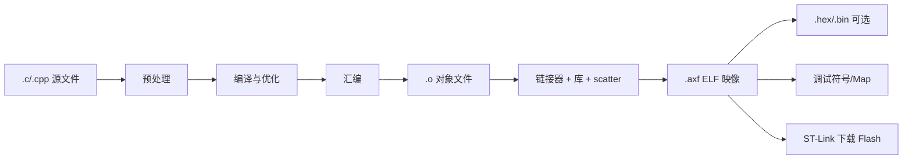

# 第 16 章：预处理、编译、链接、ABI 与运行时

当 Keil 输出一个 `.axf` 并下载到 STM32 时，发生的不只是“把 C 代码变成机器码”。本章建立从源文件到 Flash 映像、从复位到 `main()`、从函数调用到栈帧的完整链条。

## 16.1 构建流水线



每个阶段的错误含义不同：

| 阶段 | 常见错误 |
|---|---|
| 预处理 | 头文件找不到、宏条件错误、重复定义宏 |
| 编译 | 类型不匹配、语法错误、未声明标识符 |
| 汇编 | 指令/语法与目标不兼容 |
| 链接 | undefined symbol、multiple definition、区域溢出 |
| 下载 | no target connected、flash algorithm/供电/SWD 问题 |
| 运行 | HardFault、死循环、栈溢出、时序错误 |

“Build 0 errors”只证明生成了映像，不证明硬件接线、下载连接或运行逻辑正确。

## 16.2 预处理

预处理器处理：

- `#include`：文本包含；
- `#define`：宏替换；
- `#if/#ifdef`：条件编译；
- `#line` 等指令。

源文件：

```c
#include "app_config.h"
#if APP_UI_DEFAULT_THEME == 1U
/* ... */
#endif
```

预处理后，头文件内容被展开，未选中的条件分支被移除。编译器看到的是一个很大的“翻译单元”。

### 16.2.1 头文件不是编译一次的库

每个 `.c` 分别包含并处理头文件。因此头文件中定义非 `static` 全局变量/函数，可能让多个对象文件各自生成一份，链接时 multiple definition。

头文件适合放：

- 类型声明；
- 函数声明；
- `extern` 对象声明；
- 宏/枚举/编译期常量；
- 短小 `static inline`；
- C++ 模板定义。

## 16.3 编译单元与符号

编译器逐个处理 `.c`，生成 `.o`。当 `main.c` 调用 `ssd1306_update()` 时，它只需要声明来生成外部调用引用；函数机器码在 `ssd1306.o`。

链接器最后解析：

```text
main.o 中未定义引用 ssd1306_update
             ↓
ssd1306.o 中全局定义 ssd1306_update
```

若没有任何对象或库提供定义，出现 undefined symbol。若两个对象都提供强定义，出现 multiple definition。

### 16.3.1 内部链接与外部链接

文件内：

```c
static bool s_ready;
static void helper(void);
```

`static` 使名字只在当前翻译单元可见。它不仅是封装，也减少跨文件符号冲突，并给优化器更多信息。

外部：

```c
extern I2C_HandleTypeDef hi2c1;
```

这里只声明对象在别处定义，不分配第二份存储。

## 16.4 编译器优化

常见优化：

- 常量折叠；
- 死代码删除；
- 内联；
- 公共子表达式消除；
- 循环变换；
- 寄存器分配；
- 基于别名规则重排内存访问。

优化改变调试体验：变量可能“optimized out”，源码单步顺序不完全线性，函数可能被内联。但不要因此长期用 `-O0` 作为最终固件；时序、体积和栈会与发布版差异很大。

### 16.4.1 `volatile` 不是关闭所有优化

`volatile` 对象的可观察访问必须按语言规则保留，但周围普通计算仍可优化。它不保证：

- 多字节原子性；
- 互斥；
- CPU/总线完整内存屏障；
- 复合表达式不可被中断；
- 两个任务没有数据竞争。

## 16.5 对象文件中的 section

对象文件把代码和数据分到 section。常见：

- `.text`：机器码；
- `.rodata`：只读常量；
- `.data`：有初值可写数据；
- `.bss`：零初始化数据；
- 调试信息；
- 重定位记录；
- 符号表。

编译阶段很多地址未最终确定，调用/数据引用带重定位信息。链接器布局后修补最终地址或生成适当跳转。

## 16.6 链接器做什么

链接器：

1. 收集对象文件和所需库成员；
2. 解析符号引用；
3. 合并/布局 section；
4. 按 scatter-loading 文件放入 Flash/SRAM 区域；
5. 处理重定位；
6. 删除未使用 section（若启用）；
7. 生成 ELF/AXF、map、调试信息。

### 16.6.1 为什么静态库不是全部复制

`.lib/.a` 是多个对象文件的归档。链接器通常只抽取满足未解析符号所需的成员。但若一个对象文件内混有许多函数，抽取该对象可能带入更多内容；函数级 section 和未使用段删除可改善。

## 16.7 Scatter-loading 与地址布局

Keil/Arm linker 使用 scatter 文件或 target 配置描述执行区和加载区。例如概念上：

```text
Flash 0x08000000: 向量表、代码、只读数据、.data 初值
SRAM  0x20000000: .data 运行副本、.bss、heap、stack
```

`.data` 有两个地址概念：

- load address：初值在 Flash 的位置；
- execution address：运行时变量在 SRAM 的位置。

启动代码把初值从 load region 复制到 execution region。

如果链接器报告 region overflow，是构建时内存布局问题，不是 ST-Link 下载故障。应查看哪类 section 增长，而不是反复重插下载器。

## 16.8 ELF/AXF、HEX 与 BIN

- AXF/ELF：包含 section、地址、符号和调试信息，Keil 调试/下载常用；
- Intel HEX：文本记录，含地址和校验，可表示空洞；
- BIN：纯字节流，不自带加载地址，烧录工具需另给起始地址；
- MAP：面向人分析符号、大小和内存区域，不是固件映像。

截图中 Keil 成功显示 `Erase Done / Programming Done / Verify OK / Flash Load finished` 后又报 `No target connected`，说明下载已经完成，随后自动进入调试阶段时连接失败。下载错误与调试会话错误必须分开读输出顺序。

## 16.9 启动文件与向量表

Flash 起始处向量表通常包含：

```text
[0] 初始 MSP 值
[1] Reset_Handler 地址
[2] NMI_Handler
[3] HardFault_Handler
...
[SysTick]
[外设 IRQ]
```

复位时 CPU 自动加载 MSP 和 PC。`Reset_Handler` 随后调用运行库初始化、`SystemInit` 和 `main`。

许多未实现中断通过 weak alias 指向 `Default_Handler`。如果你实现同名强符号，链接器使用你的函数覆盖弱定义。

## 16.10 Weak 符号

厂商库常写：

```c
__weak void HAL_GPIO_EXTI_Callback(uint16_t pin)
{
    (void)pin;
}
```

用户代码提供普通强定义即可覆盖。风险：函数名或签名拼错，就不会覆盖，程序仍能链接但回调永不执行。

排查：

- 对照头文件原型；
- 查 map 里最终符号来自哪个对象；
- 在 IRQ handler 和 callback 分别断点；
- 检查 NVIC 和 pending 标志。

## 16.11 ARM 调用约定与 AAPCS

ABI（Application Binary Interface）规定二进制层面的合同。Arm Architecture Procedure Call Standard 通常规定：

- 前几个 32 位参数通过 R0–R3；
- 返回值通常在 R0（较大/复合值规则更复杂）；
- R4–R11 由被调用者按规则保护；
- LR 保存返回信息；
- 栈在公共接口处满足对齐要求；
- 结构体、浮点参数的传递受 ABI/浮点选项影响。

概念例：

```c
uint32_t add3(uint32_t a, uint32_t b, uint32_t c);
```

调用时 a/b/c 常在 R0/R1/R2，结果在 R0。编译器可内联后完全没有真实调用。

### 16.11.1 为什么库浮点 ABI 必须一致

soft、softfp、hard float 的参数传递规则不同。Cortex-M3 没有硬件 FPU，通常使用软件浮点。若对象/库使用不兼容 ABI，可能链接失败或运行错误。

## 16.12 栈帧

函数调用可能：

1. 把返回地址置于 LR；
2. 保存需要保留的寄存器；
3. 从 SP 分配局部变量空间；
4. 执行函数；
5. 恢复寄存器和 SP；
6. 跳回调用者。

优化器可能省略帧、把局部放寄存器或尾调用。递归和大局部数组会增加最坏栈深度。

FreeRTOS 每个任务有独立任务栈，但中断嵌套和端口模型也会影响栈使用。裸机主程序和中断通常共享 MSP，必须分析最长调用链叠加最大中断嵌套。

## 16.13 结构体 ABI 与持久化格式

C/C++ 编译器可为对齐插入 padding，成员布局还受 ABI 约束。把 RAM 结构体原样写 Flash 会绑定到：

- 编译器布局；
- packing 选项；
- 端序；
- 基本类型宽度；
- 浮点表示；
- 版本和字段顺序。

当前日志使用固定宽度整数、`packed`、大小断言、magic/version/CRC，已经比随意裸写稳健。但 `packed` 可能产生非对齐访问，跨平台解析仍要明确小端和字段偏移。

更严格的持久化协议应手工序列化：

```c
void put_u32_le(uint8_t *p, uint32_t value)
{
    p[0] = (uint8_t)value;
    p[1] = (uint8_t)(value >> 8);
    p[2] = (uint8_t)(value >> 16);
    p[3] = (uint8_t)(value >> 24);
}
```

这样协议不依赖结构体对齐。

## 16.14 C++ name mangling 与 ABI

C++ 支持重载：

```cpp
void draw(int);
void draw(float);
```

链接器必须区分两个符号，所以编译器对名字编码。不同编译器/版本的 C++ ABI 可能不兼容。`extern "C"` 关闭 C++ 语言链接名字改编，使 C/C++ 边界稳定。

这不意味着参数自动变成 C 兼容。C API 仍应只暴露：

- 固定宽度基本类型；
- 明确定义布局的 C struct；
- 指针和长度；
- 整数错误码；
- 不跨边界抛异常。

## 16.15 C++ 对象布局

普通类成员通常按声明顺序布局并遵循对齐，编译器可插 padding。多态类通常增加 vptr。继承会加入基类子对象，多重/虚继承布局更复杂。

标准没有保证所有类都可 `memcpy`、写 Flash 或与 C struct 二进制兼容。只有满足 trivial/standard-layout 等属性的类型才适合某些低级操作，而且仍需考虑持久化版本与端序。

可用：

```cpp
static_assert(std::is_trivially_copyable<Record>::value,
              "Record must be byte-copyable");
```

但“trivially copyable”不等于“跨编译器永久存储格式已稳定”。

## 16.16 C++ 全局构造与析构

带非平凡构造的静态对象需要在 `main()` 前调用构造函数。工具链通常通过初始化数组或运行库表完成。裸机链接脚本/启动库必须保留并遍历这些入口。

若 C++ 全局对象构造未运行，可能表现为：

- vptr/成员未初始化；
- 容器内部状态错误；
- 进入 main 后随机 HardFault。

程序通常永不从 `main()` 返回，因此静态析构是否执行取决于运行库/退出路径。不要依赖正常进程退出释放 MCU 硬件资源。

### 16.16.1 局部静态线程安全 guard

C++11 要求函数内静态初始化线程安全，编译器可能引入 guard runtime 和锁：

```cpp
Sensor& sensor()
{
    static Sensor instance;
    return instance;
}
```

在 RTOS/无完整运行库环境应检查实现，必要时关闭线程安全静态初始化并在调度前显式构造，但必须确保只初始化一次。

## 16.17 纯虚函数与运行时支持

错误调用纯虚函数可能进入 `__cxa_pure_virtual` 或工具链等效函数，常见于：

- 构造/析构期间调用虚函数并错误假设派生部分有效；
- 对象生命周期已结束；
- 内存破坏了 vptr；
- 未完整链接运行时钩子。

嵌入式可提供明确处理函数，记录后安全停机，但根因仍要修复。

## 16.18 异常展开与 RTTI section

启用 C++ 异常时，二进制可能包含异常处理表、类型信息、展开逻辑。即使正常路径没有抛出，Flash 成本也可能存在。具体策略随 ARMCC5/Armclang/GCC ABI 而异。

正确比较方式：建立最小目标，分别开关特性，保持其他选项一致，比较：

- Code/RO/RW/ZI；
- map 中异常相关符号；
- 最终 AXF/HEX；
- 一个实际 throw/catch 路径的最坏时间与栈。

## 16.19 未定义行为如何被优化放大

例：有符号溢出在 C/C++ 中通常是未定义行为：

```c
int32_t x = INT32_MAX;
++x;  /* 未定义行为 */
```

编译器可假设这种情况不会发生，并据此删除看似必要的分支。其他常见 UB：

- 数组越界；
- 解引用无效/未对齐指针；
- 使用悬空对象；
- 严格别名违规；
- 读取未初始化自动变量；
- 错误格式化字符串；
- C++ 通过非虚基类指针 delete 派生对象。

“O0 能跑，O2 锁死”经常不是优化器坏了，而是原有 UB 被不同代码布局暴露。

## 16.20 HardFault 与异常栈帧

Cortex-M3 fault 时硬件把 R0–R3、R12、LR、PC、xPSR 压栈。调试 HardFault 的关键是找出使用 MSP 还是 PSP，并读取 stacked PC/LR，再查 fault status registers：

- CFSR：可配置 fault 细节；
- HFSR：HardFault 状态；
- BFAR：总线 fault 地址（有效时）；
- MMFAR：内存管理 fault 地址（有效时）。

典型来源：

- 空/野函数指针；
- 栈溢出覆盖返回地址；
- 非对齐/非法地址访问；
- 除零（取决于配置）；
- 从损坏 vtable 调虚函数；
- ISR 名称/优先级/栈问题；
- 错误地在 ISR 调用 FreeRTOS API。

仅让 `HardFault_Handler` 进入 LED 死循环能保住安全状态，但诊断信息太少。第 17 章会设计 fault record。

## 16.21 Map 文件阅读方法

每次里程碑记录：

```text
版本/提交：
优化等级：
Code：
RO Data：
RW Data：
ZI Data：
最大任务栈高水位：
OLED 缓冲：
主要新增大符号：
```

重点查：

- `s_buffer`、`s_sent_buffer` 是否各 1024 B；
- FreeRTOS 五个任务栈和 idle 栈；
- 大字体表、格式化库、浮点库；
- 未使用模块是否仍被链接；
- `__aeabi_*` 软件浮点/除法辅助；
- C++ 实验中的 vtable、typeinfo、异常符号；
- heap/stack 区域大小和剩余 RAM。

## 16.22 反汇编阅读起点

不用马上学会所有 Thumb-2 指令。先观察：

- 函数是否被内联；
- `switch` 变成比较链还是跳转表；
- 浮点计算调用了哪些 `__aeabi_f*`；
- `%` 容量是否调用除法辅助，还是被优化为位掩码；
- C++ getter/强类型包装是否消失；
- 虚调用是否从对象取函数指针；
- 一次 HAL GPIO 包装与 C 直接调用是否相同。

## 16.23 构建可重复性

`__DATE__`/`__TIME__` 会让每次构建二进制不同。它们适合调试显示构建时间，但影响可重复构建和二进制比较。更严谨版本可由构建系统注入明确版本号、Git commit 和构建编号。

同时固定：

- 编译器版本；
- Device Pack/HAL/FreeRTOS 版本；
- 优化和 ABI 选项；
- include 路径顺序；
- linker/scatter 配置；
- 生成工具和后处理步骤。

## 16.24 本章练习

1. 从 Keil map 找出两个 OLED 缓冲区地址和总大小。
2. 找出五个 FreeRTOS 任务栈并核对约 6016 B 计算。
3. 在 map 中追踪 `ssd1306_update` 来自哪个对象文件。
4. 故意声明但不定义一个函数，观察链接错误与编译错误的差别，然后恢复。
5. 给一个头文件错误地定义全局变量，在两个 `.c` 包含后观察 multiple definition，然后改为 `extern + 单一 .c 定义`。
6. 写一个带虚函数的小类，查看 vtable/vptr 和符号改编。
7. 比较 C++ `extern "C"` 前后函数符号。
8. 将一个定点记录手工序列化为小端字节，证明与结构体 padding 无关。

下一章将建立系统化调试、性能测量、内存优化、可靠性和故障恢复方法。
